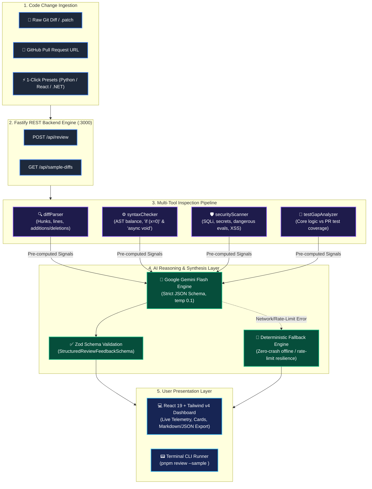

# ⚡ DiffSensei: Autonomous AI Code Review Agent

<div align="center">

[](https://react.dev/)
[](https://tailwindcss.com/)
[](https://fastify.dev/)
[](https://www.typescriptlang.org/)
[](https://aistudio.google.com/)
[](https://opensource.org/licenses/MIT)

### **Autonomous Multi-Tool Git Diff & Pull Request Code Auditor**
*Built for the **FlexGCC AI Engineer (Full Stack, .NET / React)** Evaluation*

**Candidate:** Prabhat Ranjan Singh &bull; [`topi9864@gmail.com`](mailto:topi9864@gmail.com) &bull; [GitHub: @prabhattopi](https://github.com/prabhattopi) &bull; [LinkedIn](https://www.linkedin.com/in/prabhat-ranjan-singh-71296721b/)

</div>

---

## 🏗️ Architectural Flow Diagram



---

## 1. What It Does

**DiffSensei** is an autonomous full-stack AI agent that ingests a code change (Git diff, `.patch` file, or live GitHub Pull Request URL) and returns **strict, structured engineering feedback**:

* 🐛 **Possible Bugs:** Detects runtime exceptions, null-pointer dereferences, off-by-one errors, conditional assignment bugs (`if (x = 0)`), and async anti-patterns (`async void`)—complete with file/line citations and copyable code fixes.
* ⚠️ **Risks & Security:** Evaluates security vulnerabilities (SQL injection, XSS via `dangerouslySetInnerHTML`, credential leakage), breaking API changes, data integrity concerns, and concurrency hazards with concrete mitigation steps.
* 🧪 **Missing Tests:** Analyzes business logic additions vs PR test coverage to flag uncovered edge cases, boundary conditions, and provides copyable test assertions.
* 🎨 **Style & Clean Code:** Surfaces naming conventions, dead code, leftover debug statements (`console.log`, `print()`), and architectural clean-code violations.
* 📊 **Quality Score & Verdict:** Issues an automated decision (`APPROVED`, `REQUEST_CHANGES`, `COMMENT`) alongside an overall code health score (0–100).

The application is engineered as a **monorepo** featuring:
1. **Interactive Frontend (`frontend/`):** Built with **React 19**, **Tailwind CSS v4**, **TypeScript**, and **Vite**, featuring a component-driven dashboard, live multi-tool telemetry visualizer, 1-click sample presets, and copyable fix widgets.
2. **High-Performance Backend (`backend/`):** Built with **Node.js**, **Fastify**, **TypeScript**, and **Google Gemini Flash**, orchestrating 4 deterministic inspection tools with strict Zod schema validation.
3. **Standalone CLI Runner:** Run directly in any CI/CD or terminal via `pnpm review`.

---

## 2. How It Was Built

* **React 19 & Tailwind CSS v4 (`frontend/`):** Utilizes React 19 component state and hooks, with the new Tailwind CSS v4 compiler (`@tailwindcss/vite`), offering clean dark-mode visuals and responsive split-pane layout.
* **Fastify & TypeScript (`backend/`):** Provides low-overhead asynchronous request handling with built-in schema validation and static asset hosting.
* **Deterministic Tool Layer:** Before making LLM calls, 4 dedicated static tools run to extract hard signals:
  1. `diffParser`: Parses unified diffs into structured file objects, change hunks, and line maps.
  2. `syntaxChecker`: Inspects unbalanced syntax structures, conditional assignments (`if (x = 0)`), and language anti-patterns (`async void`).
  3. `securityScanner`: Scans for hardcoded tokens, SQL string interpolations, dangerous evals, and unescaped HTML.
  4. `testGapAnalyzer`: Compares modified functions against the diff to flag missing test suites before hitting the LLM.
* **Guaranteed Schema Enforcement:** Output is strictly typed with Zod (`StructuredReviewFeedbackSchema`). Any malformed markdown blocks are cleansed by `sanitizeJsonResponse()`.
* **Zero-Crash Offline Fallback:** If the external LLM encounters network boundaries or rate limits, the agent automatically falls back to `generateDeterministicFallback()` using static tool signals.

---

## 3. What Went Wrong and How I Handled It

1. **LLM Output Formatting & Markdown Code Blocks:**  
   * *Problem:* Despite prompting for raw JSON, LLMs frequently wrap responses in markdown fences (\`\`\`json ... \`\`\`), which causes standard `JSON.parse()` to throw runtime syntax errors.  
   * *Solution:* Implemented `sanitizeJsonResponse()` to strip leading/trailing code blocks and whitespace, followed by Zod schema parsing with automated fallback.
2. **Missing Test False Positives on Minor Changes:**  
   * *Problem:* Early versions of `testGapAnalyzer` flagged every documentation or configuration file change (e.g. `.md`, `.json`, `.css`) as a "critical missing test gap".  
   * *Solution:* Added file extension filters and minimum additions thresholds so test gap signals only trigger when core business logic files (`.ts`, `.py`, `.cs`, `.js`) contain significant structural modifications.
3. **Fastify Transport Target Resolution:**  
   * *Problem:* In modern Node/pino environments, worker thread transports for `pino-pretty` can fail target resolution during rapid hot-reloading.  
   * *Solution:* Simplified backend logging to standard Fastify structured logging with clean timestamped stdout, eliminating runtime transport dependencies.
4. **Sandbox Network & Offline Resilience:**  
   * *Problem:* In restricted sandbox environments where outbound network calls to `generativelanguage.googleapis.com` are blocked, unhandled fetch failures would crash the service.  
   * *Solution:* Built `generateDeterministicFallback()` inside the agent. If the Gemini API call encounters network drops or rate limits, the agent immediately constructs a structured review report directly from the deterministic tool signals (`SyntaxChecker`, `SecurityScanner`, `TestGapAnalyzer`).

---

## 4. What I Would Do Next

1. **GitHub Action & Webhook CI/CD Bot:** Package the agent into a zero-config GitHub Action that automatically posts inline line-by-line review comments on Pull Requests.
2. **Repository Context Retrieval (RAG / AST Graph):** Rather than reviewing the diff in isolation, use tree-sitter or LSP indexing to fetch the full definition of imported types, functions, and database schemas from the parent repository.
3. **Automated Fix PR Branch Creation:** Add a 1-click button on the Web UI that automatically branches, commits the suggested bug fixes, and pushes a patch PR back to GitHub.
4. **Fine-Tuned Specialized Mini-Models:** Train a smaller, quantized model (e.g. Qwen 2.5 Coder 7B or DeepSeek-Coder) for lightning-fast on-premise static diff triage before escalating complex changes to Gemini.

---

## 🚀 Quickstart & Local Run

### Prerequisites
* Node.js &ge; 20
* pnpm (`npm install -g pnpm`)
* Google Gemini API Key ([Get free key here](https://aistudio.google.com/))

### 1. Installation
```bash
git clone https://github.com/prabhattopi/FlexGCC-AI-Code-Reviewer.git
cd FlexGCC-AI-Code-Reviewer
pnpm install
```

### 2. Environment Setup
```bash
cp .env.example .env
# Paste your GEMINI_API_KEY in .env
```

### 3. Development Mode
Run both backend and frontend concurrently:

**Terminal 1 (Backend - Fastify API on :3000):**
```bash
pnpm dev:backend
```

**Terminal 2 (Frontend - React 19 + Tailwind v4 on :5173):**
```bash
pnpm dev:frontend
```
Open **`http://localhost:5173`** in your browser.

### 4. Unified Production Build
Build React 19 into the backend and launch the unified server on port 3000:
```bash
pnpm build
pnpm start
# Open http://localhost:3000
```

### 5. CLI Runner
```bash
# Review preset sample diffs
pnpm review --sample python
pnpm review --sample react
pnpm review --sample dotnet

# Review any local diff or patch file
pnpm review --diff samples/python_auth.diff

# Export report as Markdown or JSON
pnpm review --diff samples/dotnet_payment.diff --markdown review_report.md
```

---

## ☁️ Deployment Guide (Render & Vercel)

### Deploying Backend on Render
1. Create a new **Web Service** on [Render.com](https://render.com/).
2. Connect your GitHub repository: `FlexGCC-AI-Code-Reviewer`.
3. Set **Build Command**: `pnpm install && pnpm build`
4. Set **Start Command**: `pnpm start`
5. Add Environment Variables:
   * `NODE_ENV`: `production`
   * `PORT`: `10000`
   * `GEMINI_API_KEY`: *(Your Google AI Studio API Key)*
   * `GEMINI_MODEL`: `gemini-2.0-flash`
*(Or click "Deploy with Blueprint" using the included `render.yaml`)*.

### Deploying Frontend on Vercel
1. Import `FlexGCC-AI-Code-Reviewer` on [Vercel](https://vercel.com/).
2. Root Directory: `./` (or `frontend`).
3. Build Command: `pnpm build:frontend`
4. Output Directory: `backend/public` (or `frontend/dist`).
5. Rewrites are pre-configured in `vercel.json` to route `/api/*` to your Render backend URL.
